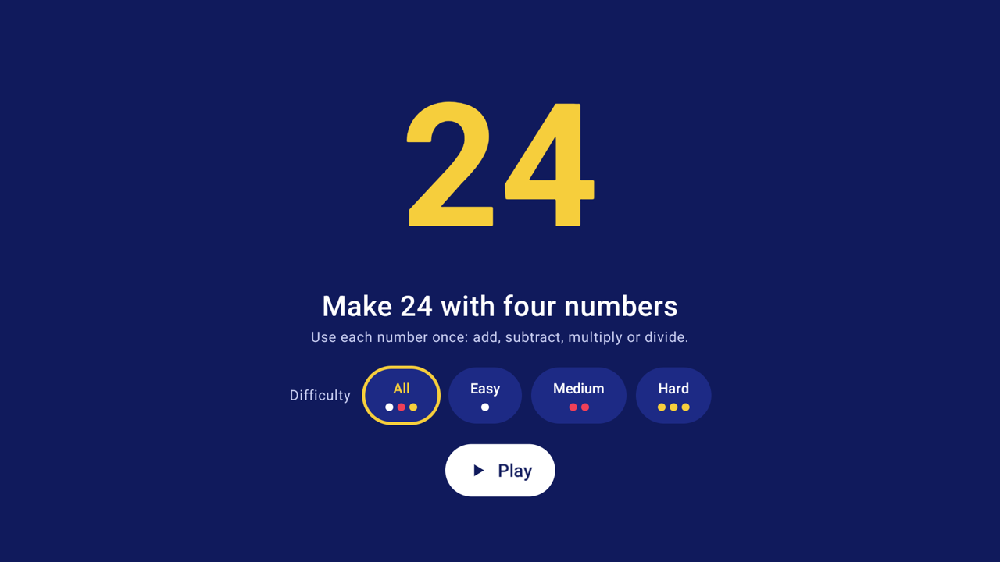
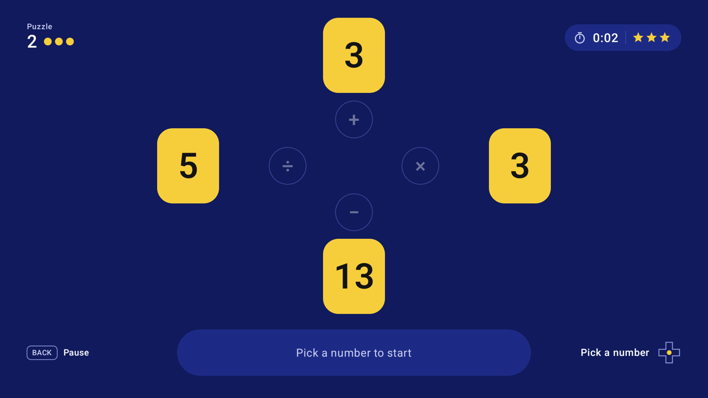
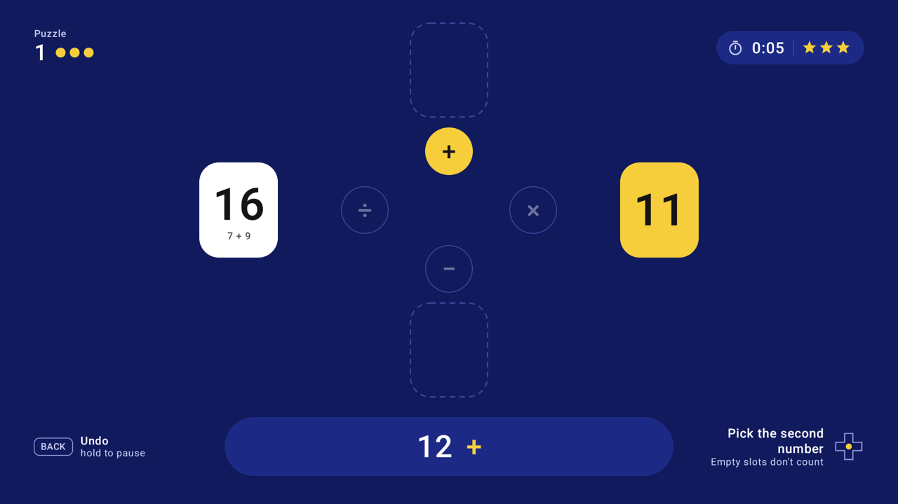
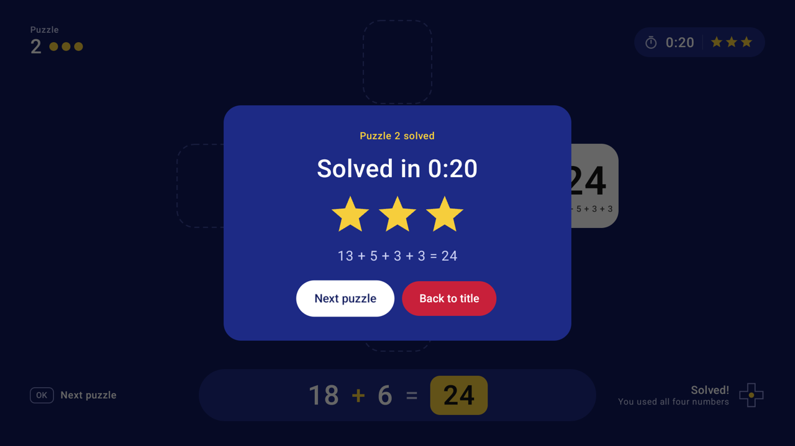
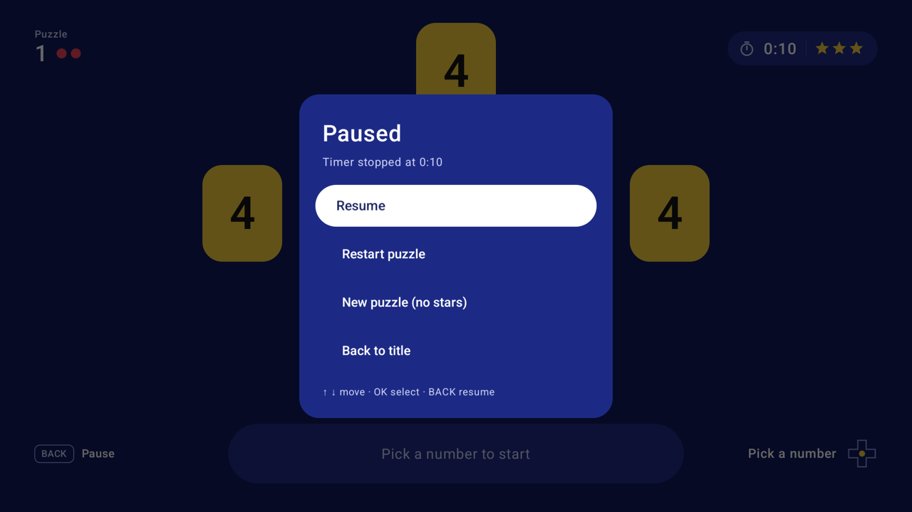

# 24

A 24 game for Android TV. You get four numbers and have to make 24 using + − × ÷. The whole game is played with the remote: just the D-pad, OK and Back.



| | |
|:---:|:---:|
|  |  |
| A new puzzle | Partway through |
|  |  |
| Solved | Paused |

## How to play

The four numbers sit around four operators, and each operator matches a direction on the D-pad:

| Direction | Operator |
|:---:|:---:|
| ↑ | + |
| ↓ | − |
| ← | ÷ |
| → | × |

1. Press a direction to pick a number.
2. Press a direction to pick an operator.
3. Press a direction to pick a second number.

The two numbers combine, and the result takes the second number's place. Keep going until one card is left. If it's 24, you've solved the puzzle. If it isn't, the cards go back to the start so you can try again.

- Use each number exactly once.
- Fractions and negative numbers are fine along the way, but you can't divide by zero.
- **Back** undoes your last step. When there's nothing to undo, it pauses. Hold it to open the pause menu at any time.

### Stars

Solve a puzzle in 30 seconds or less for ★★★, in a minute or less for ★★, or take as long as you like for ★. Restarting a puzzle doesn't reset the clock, and skipping to a new puzzle earns no stars.

### Difficulty

Choose a difficulty on the title screen: **All**, **Easy**, **Medium** or **Hard**. The game remembers your choice. During play, dots next to the puzzle number show how hard the current puzzle is: one white dot for Easy, two red for Medium, three yellow for Hard.

Puzzles come from every combination of four numbers from 1 to 13 that can make 24. Combinations that can't make 24 are left out.

## Languages

The game uses your TV's system language. It's translated into English, Portuguese, Spanish, French and German. Any other system language gets English.

## Install

You need an Android TV or Google TV device with Android 9 or later and [developer options and USB or network debugging turned on](https://developer.android.com/studio/debug/dev-options). You also need the [Android SDK platform tools](https://developer.android.com/tools/releases/platform-tools) for `adb`.

Build the release APK. Gradle needs JDK 17 or later; Android Studio's bundled JDK works:

```bash
export JAVA_HOME="/Applications/Android Studio.app/Contents/jbr/Contents/Home"
./gradlew :app:assembleRelease
```

Connect to the TV and install:

```bash
adb connect <tv-ip-address>:5555
adb install -r app/build/outputs/apk/release/app-release.apk
```

Open **24** from the TV's app list once, then precompile it so the animations are smooth from the start:

```bash
adb shell cmd package compile -f -m speed-profile com.jjmluz.twentyfour
```

Install the release build, not the debug build. The debug build isn't optimised, and its animations stutter on real TVs. The release build is signed with the debug key: that's fine for sideloading, but you'd need a real key to publish on the Play Store.

## Development

The game is written in Kotlin with Jetpack Compose for TV.

| Path | What's there |
|---|---|
| `app/src/main/java/com/jjmluz/twentyfour/game/` | Game rules and puzzles, in plain Kotlin with no Android code |
| `app/src/main/java/com/jjmluz/twentyfour/ui/` | Screens, theme and the view model |
| `app/src/main/res/values*/strings.xml` | All on-screen text, one file per language |
| `solutions.json` | The puzzle database, copied into the app at build time |
| `tools/generate_sounds.py` | Generates the sound effects in `app/src/main/res/raw` |

Run the unit tests:

```bash
./gradlew :app:testDebugUnitTest
```

[AGENTS.md](AGENTS.md) has the conventions to follow when changing the code.
